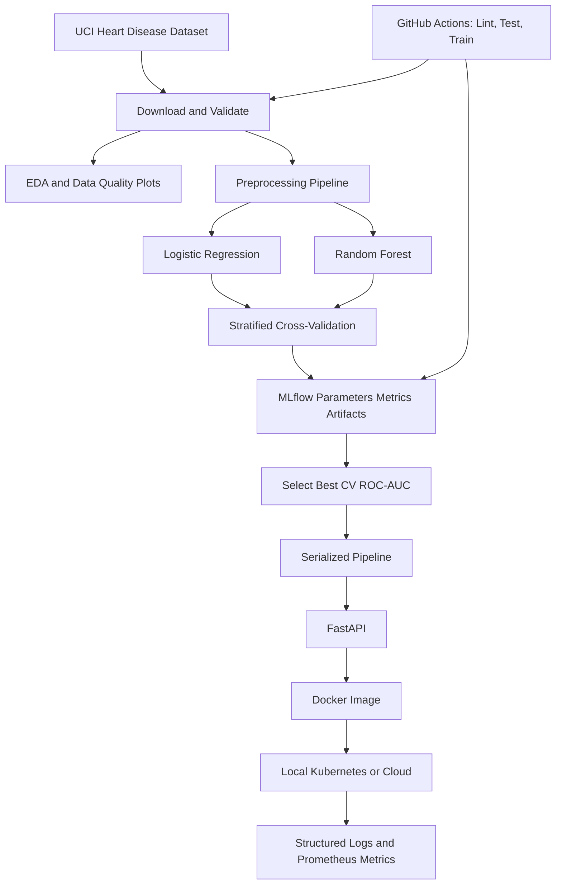

**Course:** AIMLCZG523 — MLOps  
**Assignment:** 01  
**Student:** Vaishnavi Verma / 2025AE05339 
**Repository:** https://github.com/vermavaishnavi03/MLOps-Assignment
**Video Link:**  https://github.com/vermavaishnavi03/MLOps-Assignment/tree/main/recording
**Deployment URL or local access instructions:** No hosted deployment is there. For local access, start the API from the repository root with `uvicorn heart_ml.api:app --host 127.0.0.1 --port 8000` after installing dependencies and setting `PYTHONPATH=src`; open `http://127.0.0.1:8000/docs`. Check Appendix A which has details.

## 1. Abstract
This project implements a reproducible educational binary-classification workflow using the Cleveland subset of the UCI Heart Disease dataset (303 rows, 13 input features). The original target severity values are converted to a binary label: 0 means no disease and values 1–4 mean disease present. Logistic Regression and Random Forest are compared using stratified five-fold cross-validation and a held-out test set. The checked-in results select Logistic Regression by mean CV ROC-AUC (0.902 +/- 0.015), although Random Forest has higher test accuracy (0.885 versus 0.869) and recall (0.964 versus 0.929). The project also contains an MLflow integration, FastAPI service, Docker/Kubernetes configuration, GitHub Actions workflow, and Prometheus instrumentation. A successful live deployment, CI run, and API response were not verified, so none are claimed.

## 2. Problem statement and objectives
The engineeripinng objective is to build a repeatable machine-learning workflow and serve its binary classifier through a JSON API. The project acquires and validates data, generates descriptive summaries and plots, fits preprocessing within the training workflow, compares candidate estimators, saves the selected full pipeline, and defines local container and Kubernetes deployment paths.

This is coursework and an educational demonstration, not a medical device. The dataset and model are not suitable for diagnosis, treatment, triage, or any clinical decision.

## 3. System architecture
The implementation flow represented by `reports/architecture.mmd` is:



The diagram describes configured project components, not proof that each deployment or CI stage has been executed successfully.

## 4. Dataset acquisition and understanding
The downloader fetches UCI Machine Learning Repository dataset ID 45 through `ucimlrepo`, uses the Cleveland schema, normalizes column names, maps the original `num` severity target to `target = 0` when `num == 0` and `target = 1` when `num > 0`, and writes `data/raw/heart_disease.csv`.

The checked-in descriptive-statistics and missing-value summaries report **303 rows and 14 columns**: 13 features (`age`, `sex`, `cp`, `trestbps`, `chol`, `fbs`, `restecg`, `thalach`, `exang`, `oldpeak`, `slope`, `ca`, `thal`) plus the binary target. There are 164 examples of class 0 and 139 of class 1 (45.9% positive). Six feature values are missing: four in `ca` and two in `thal`; the target has no missing values. No other feature has missing values in the summary.

These counts are from `reports/figures/descriptive_statistics.csv` and `reports/figures/missing_values.csv`. The numeric summaries show age from 29 to 77 years (mean 54.44), resting blood pressure from 94 to 200 (mean 131.69), and cholesterol from 126 to 564 (mean 246.69). They describe this dataset only and should not be interpreted as population estimates.

## 5. EDA
`src/heart_ml/eda.py` generates feature histograms, a numeric correlation heatmap, and a target-class count plot, as well as CSV descriptive and missing-value summaries. The CSV summaries are present. The generated PNG plots are not present in the current project state, so this report does not make visual claims about individual feature distributions or correlations. Run the EDA command in Appendix A and inspect the plots before adding plot-based interpretations or screenshots.

The tabulated target counts show a modest class imbalance (164 class-0 versus 139 class-1 records), rather than an extreme imbalance. The missingness is limited to six values across `ca` and `thal`; the training pipeline imputes those values rather than discarding rows. Cholesterol ranges up to 564, which merits inspection but cannot, by itself, establish an error or outlier.

## 6. Preprocessing and feature engineering
The preprocessing is part of the scikit-learn `Pipeline` saved with the estimator:

- Numeric columns (`age`, `trestbps`, `chol`, `thalach`, `oldpeak`) use median imputation followed by standard scaling.
- Categorical columns (`sex`, `cp`, `fbs`, `restecg`, `exang`, `slope`, `ca`, `thal`) use most-frequent imputation followed by one-hot encoding. Unknown categories at inference are ignored by the encoder.
- The target is not included among the input features. The original severity target is reduced to a binary label during acquisition.

The data is split once into 80% training and 20% held-out test data using `random_state=42` and stratification. Five-fold stratified cross-validation, also shuffled with random state 42, is run on the training partition. Because preprocessing is inside the estimator pipeline, each cross-validation fold fits its imputation, scaling, and encoding steps using that fold's training rows only. The full pipeline is then fitted on the entire training partition and evaluated once on the held-out test partition.

## 7. Model development and evaluation
Both models use `class_weight="balanced"`. Logistic Regression uses `max_iter=2000`; Random Forest uses 300 trees and `min_samples_leaf=2`. Results below are copied from `artifacts/metrics.json`. Cross-validation entries are mean +/- standard deviation across the five folds; test entries are held-out metrics.

| Model | CV accuracy | CV precision | CV recall | CV ROC-AUC | Test accuracy | Test precision | Test recall | Test ROC-AUC |
|---|---:|---:|---:|---:|---:|---:|---:|---:|
| Logistic Regression | 0.855 +/- 0.024 | 0.873 +/- 0.062 | 0.810 +/- 0.062 | **0.902 +/- 0.015** | 0.869 | 0.813 | 0.929 | **0.966** |
| Random Forest | 0.802 +/- 0.017 | 0.783 +/- 0.029 | 0.792 +/- 0.095 | 0.898 +/- 0.029 | **0.885** | **0.818** | **0.964** | 0.951 |

The selection rule is highest mean five-fold cross-validation ROC-AUC. Logistic Regression wins that comparison by about 0.005 and is consequently saved as `artifacts/model.joblib`, even though Random Forest is higher on all four reported held-out metrics. This illustrates that the selected cross-validation metric and single-split test metrics answer different questions; the held-out set is small (61 records), so these differences should not be treated as evidence of a reliable real-world ranking.

For the selected Logistic Regression, the saved classification report gives 33 class-0 and 28 class-1 test examples. Class-1 precision is 0.81 and recall is 0.93; the rounded report implies 26 true positives, 2 false negatives, and 6 false positives. False negatives and false positives can both cause harm, and this model has not been calibrated or evaluated for clinical use. The high test ROC-AUC is a result on this one split, not an estimate of clinical performance.

## 8. Experiment tracking with MLflow
The training code creates an experiment named `uci-heart-disease-classification`. For each model it logs the model name, random state, test fraction, and fold count; cross-validation means and standard deviations; held-out accuracy, precision, recall, and ROC-AUC; the fitted scikit-learn pipeline; a classification report; a confusion-matrix plot; and an ROC-curve plot. The checked-in `metrics.json` associates Logistic Regression with run ID `78895c2798a64ad89152136d808b61ca` and Random Forest with run ID `077702bf17614d688a9f707d10f927ab`.

There is a tracking-URI inconsistency to resolve when reproducing the UI: the current `train.py` explicitly sets a SQLite tracking URI at the project-root `mlflow.db`, while the README and GitHub Actions environment refer to the `mlruns/` file store. The repository also contains an `mlruns/` directory with run artifacts. The run store used for a particular execution must match the URI passed to the MLflow UI; for the current training code, start the UI from the project root with:

```powershell
mlflow ui --backend-store-uri sqlite:///mlflow.db --host 127.0.0.1 --port 5000
```

Then open `http://127.0.0.1:5000`. An experiment screenshot is not present, and the local SQLite database was not verified for this report.

## 9. Packaging, API, and reproducibility
`requirements.txt` declares bounded dependency ranges; it is not a fully pinned lockfile. `artifacts/model.joblib` contains the selected preprocessing-and-estimator pipeline. `artifacts/metadata.json` records the selected model, target description, input feature order, selection metric, best cross-validation ROC-AUC, random seed, and educational-use disclaimer. `artifacts/metrics.json` records both model comparisons.

The FastAPI application exposes `/health`, `/predict`, and `/metrics`, with interactive documentation at `/docs`. Pydantic validates each of the 13 input fields against configured bounds. `/predict` returns a binary prediction, a text label, maximum class probability as `confidence`, both class probabilities, and a disclaimer. These probabilities are model outputs, not validated medical-risk estimates. `/health` reports whether the model file exists; it does not independently prove that the model loads or that the API is ready to serve a prediction. Middleware logs request method, path, status, and duration as JSON and updates Prometheus request counters and latency histograms.

The repository's request fixture is `sample_request.json`. A live response was **not captured** for this report: the available Python environment could not import `pandas` (`ModuleNotFoundError`), a required runtime dependency. Therefore no prediction, confidence, or probability values are invented here. After installing requirements and confirming the saved model, submit the fixture to `/predict` using the command in Appendix A and record the returned JSON as runtime evidence.

## 10. CI/CD, containerization, deployment, monitoring
The checked-in GitHub Actions workflow runs on pushes, pull requests, and manual dispatches using Ubuntu and Python 3.11. It installs `requirements.txt`, runs Ruff and Pytest, downloads the UCI data, trains the models, and uploads `artifacts/`, `mlruns/`, and `reports/figures/`. The workflow file exists, but no successful run URL or screenshot is recorded. The workflow sets `MLFLOW_TRACKING_URI=file:./mlruns`; the current trainer overrides that setting with SQLite, so the training code and workflow configuration should be reconciled before relying on uploaded MLflow results.

`Dockerfile` and `docker-compose.yml` define a local API image and port mapping on 8000. The image expects `artifacts/model.joblib` to exist, so training must be completed before building. The configuration establishes the intended deployment procedure; a Docker build or running-container result was not verified for this report.

`deployment/kubernetes/deployment.yaml` defines a Deployment with two replicas and a `LoadBalancer` Service on port 80 targeting container port 8000. Readiness and liveness probes call `/health`. CPU and memory requests and limits are set. These manifests can be applied to a local Minikube or Docker Desktop Kubernetes cluster; no cluster, pod rollout, public endpoint, or cloud deployment is evidenced in the current project state. For local access, the documented port-forward command is `kubectl port-forward service/heart-api 8080:80`.

Prometheus instrumentation is implemented in the API and starter configuration exists under `monitoring/prometheus/`. The Grafana directory contains setup notes. No live scrape, dashboard screenshot, or monitoring result is recorded. The API has request logging and metrics, but the repository does not establish authentication, TLS termination, or other production security controls.

## 11. Limitations, risks, and responsible use
The dataset has only 303 records and represents an older, narrow cohort; its performance does not establish generalization to current or different populations. Missing values, measurement practices, and population differences may affect predictions. The available metrics are based on one stratified hold-out split and five-fold cross-validation on the same small dataset. There is no external validation, confidence-interval analysis, calibration assessment, subgroup fairness evaluation, prospective evaluation, or data-drift study.

The test report contains both false negatives and false positives. Their consequences differ, and this project does not define a clinically appropriate threshold or measure downstream harm. The numeric class probabilities have not been shown to be calibrated. Production use would also require privacy controls, authentication and authorization, encrypted transport, secure artifact handling, auditability, operational alerting, and a documented response to drift or failures. No personally identifiable data should be submitted to this demonstration API.

## 12. Conclusion and future work
The checked-in artifacts show that both candidate models were evaluated and that Logistic Regression was selected under the declared cross-validation ROC-AUC rule. Its mean cross-validation ROC-AUC is 0.902, while Random Forest attains higher accuracy and recall on the one held-out split. The project provides the main building blocks of an end-to-end MLOps workflow, but runtime evidence for API serving, CI, Docker, Kubernetes, and monitoring remains to be collected. The most immediate reproducibility task is to align the MLflow tracking URI across training code, CI, and UI instructions.

Further work should add external validation, calibration and threshold analysis, subgroup evaluation, explicit data/model version lineage, a consistent MLflow backend, automated deployment and rollback, stronger API security, and monitoring for data and prediction drift. Those changes would still not make the existing dataset or model clinically appropriate without independent clinical validation and governance.

## Appendix A — Setup Instructions - Reproduction
The project README specifies Python 3.11. This workspace is Windows; the actual interpreter version and exact installed package versions were not captured. Dependency ranges are in `requirements.txt`; no lockfile is present.
From the repository root, use PowerShell:

```powershell
py -3.11 -m venv .venv
.\.venv\Scripts\Activate.ps1
python -m pip install --upgrade pip
pip install -r requirements.txt
$env:PYTHONPATH = "src"

Set-ExecutionPolicy -Scope Process Bypass
.\.venv\Scripts\Activate.ps1


python -m heart_ml.data_cli
python -m heart_ml.eda
python -m heart_ml.train

Verify MLflow Exxperiment Tracking :

```powershell
.\.venv\Scripts\Activate.ps1
mlflow ui --backend-store-uri ./mlruns --host 127.0.0.1 --port 5000

ruff check src tests scripts
pytest -q

uvicorn heart_ml.api:app --host 127.0.0.1 --port 8000
```

With the API running, open `http://127.0.0.1:8000/docs`, or submit the checked-in sample request from a second PowerShell terminal:

```powershell
Invoke-RestMethod -Method Post -Uri http://127.0.0.1:8000/predict `
	-ContentType "application/json" -InFile sample_request.json
```

For local container verification, after training:

```powershell
docker build -t heart-mlops-api:local .
docker run --rm -p 8000:8000 heart-mlops-api:local
```

For deployment using minikube
```powershell
minikube start --driver=docker
kubectl get nodes

minikube image build -t heart-mlops-api:local .

kubectl apply -f deployment/kubernetes/deployment.yaml
kubectl rollout status deployment/heart-api
kubectl get pods
kubectl get services

kubectl describe pod <POD_NAME>
kubectl logs deployment/heart-api

kubectl port-forward service/heart-api 8080:80

kubectl get deployments
kubectl get pods
kubectl get services
kubectl describe deployment heart-api

kubectl apply -f deployment/kubernetes/deployment.yaml
kubectl rollout status deployment/heart-api
kubectl get pods,svc

kubectl port-forward service/heart-api 8080:80

```

For Grafana and Prometheus

```powershell

minikube image pull prom/prometheus:latest
minikube image pull grafana/grafana:latest
minikube image ls

kubectl apply -f prometheus-deployment.yaml
kubectl port-forward svc/prometheus 9090:9090

kubectl apply -f grafana-deployment.yaml
kubectl port-forward svc/grafana 3000:3000

```


